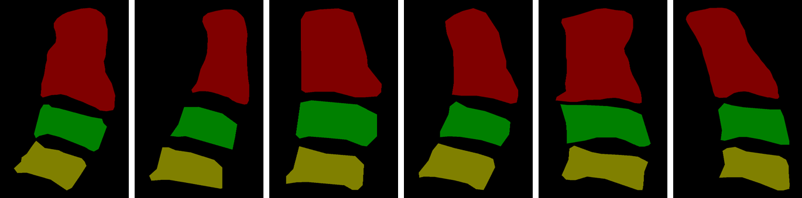

# Full C2–C4 Vertebra Annotations for the Aariz Cephalometric Dataset

Manual segmentation annotations of the **second, third and fourth cervical vertebrae (C2, C3, C4)** for lateral cephalometric radiographs from the public [Aariz dataset](https://github.com/manwaarkhd/aariz).

These annotations accompany the paper:

> **A Three-Stage Deep Learning Framework for Automated Cervical Vertebral Maturation Assessment**
> AUTHORS — *JOURNAL*, YEAR. DOI: XXXX



---

## Important: full C2 vs. the partial C2 used in the paper

**The masks in this repository outline the full, anatomically complete C2**, including the odontoid process (dens).

In the paper, the model was trained on a *partial* C2 mask covering only the **inferior portion** of the vertebra. This was a deliberate design choice: the superior and posterior borders of C2 are often obscured on lateral cephalograms, and Baccetti CVM staging depends only on the inferior border of C2 (presence and depth of the concavity). See the Discussion and Figure 8 of the paper.

We release the full C2 because it is the true anatomy and can serve more uses than our method alone. A partial, inferior-border-only C2 can always be derived from the full mask, but the reverse is not possible.

---

## What is included (and what is not)

| Included | Not included |
|---|---|
| LabelMe polygon files (`annotations/labelme/*.json`) | **The radiographs.** Download them from the official Aariz release. |
| Label masks (`annotations/masks/*.png`) | |
| Scripts to convert, visualise and check the data | |

The JSON files have had the embedded image removed (`"imageData": null`), so **no radiograph pixels are distributed in this repository.**

### Files are matched by name

Each annotation has the same name as its Aariz image:

```
Aariz image:   cl76jfqye0e5h076122wx6tkd.bmp
LabelMe JSON:  annotations/labelme/cl76jfqye0e5h076122wx6tkd.json
Mask:          annotations/masks/cl76jfqye0e5h076122wx6tkd.png
```

### Mask format

Single-channel PNG, same width and height as the original radiograph:

| Pixel value | Class | Display colour |
|:-:|---|---|
| 0 | background | black |
| 1 | **C2** (full vertebra) | red |
| 2 | **C3** | green |
| 3 | **C4** | olive |

Masks are stored as palette PNGs, so they show in colour in an image viewer but load as plain `0–3` values:

```python
import numpy as np
from PIL import Image
mask = np.array(Image.open("annotations/masks/cl76jfqye0e5h076122wx6tkd.png"))  # values 0..3
```

### LabelMe format

Standard [LabelMe](https://github.com/wkentaro/labelme) JSON with one polygon per vertebra, labelled `C2`, `C3` and `C4`. Coordinates are in pixels of the original radiograph.

---

## Usage

```bash
git clone https://github.com/shaychavoshian/cvm-vertebrae-segmentation.git
cd cvm-vertebrae-segmentation
pip install -r requirements.txt
```

**1. Get the radiographs** from the official Aariz release: <https://github.com/manwaarkhd/aariz>

**2. Visualise** the annotations on your copy of the images:
```bash
python scripts/visualize.py path/to/Aariz/images annotations/masks overlays
```

**3. Regenerate the masks from the polygons** (optional; they are already provided):
```bash
python scripts/json_to_mask.py annotations/labelme my_masks
```

**4. Check the data:**
```bash
python scripts/check_dataset.py
```

### Annotation protocol

Annotations were drawn manually in LabelMe by outlining the C2, C3 and C4 vertebral bodies on each radiograph. See the Methods section of the paper for details.

---

## Citation

If you use these annotations, please cite **both** our paper and the original Aariz dataset:

```bibtex
@article{CITEKEY,
  title   = {A Three-Stage Deep Learning Framework for Automated Cervical Vertebral Maturation Assessment},
  author  = {AUTHORS},
  journal = {JOURNAL},
  year    = {YEAR},
  doi     = {DOI}
}

@article{khalid2025benchmark,
  title   = {A Benchmark Dataset for Automatic Cephalometric Landmark Detection and CVM Stage Classification},
  author  = {Khalid, Muhammad Anwaar and Zulfiqar, Kanwal and Bashir, Ulfat and Shaheen, Areeba and Iqbal, Rida and Rizwan, Zarnab and Rizwan, Ghina and Fraz, Muhammad Moazam},
  journal = {Scientific Data},
  volume  = {12},
  number  = {1},
  pages   = {1336},
  year    = {2025}
}
```

---

## License

- **Annotations** (`annotations/`): [CC BY-NC-SA 4.0](https://creativecommons.org/licenses/by-nc-sa/4.0/), matching the terms of the Aariz dataset. Non-commercial use only; derivatives must be shared under the same license. See [`LICENSE-annotations`](LICENSE-annotations).
- **Code** (`scripts/`): MIT. See [`LICENSE`](LICENSE).
- **Radiographs**: not distributed here; governed by the Aariz dataset's own license.

## Acknowledgements

We thank the authors of the Aariz dataset for making their radiographs publicly available.

## Contact

NAME — EMAIL
